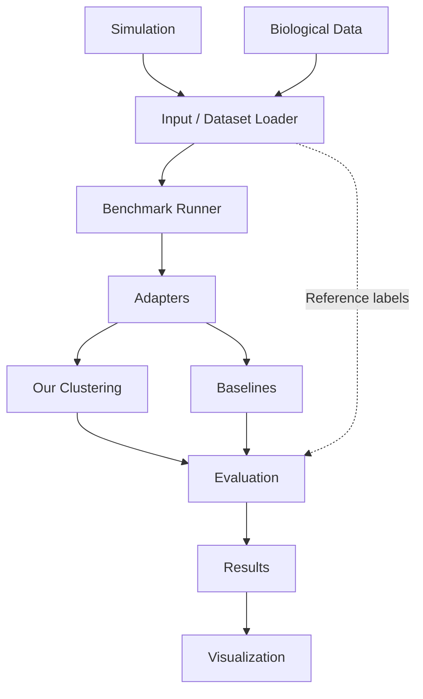

# BMI3 Project 12 — Phylogenetic Tree-Based Clustering

## 1. Project Overview

本项目旨在根据系统发育树的拓扑结构和分支长度，将基因划分为指定的 `k` 个 paralogous gene families。

- **Input:** 带分支长度的 Newick tree + `k`。
- **Output:** 每个叶节点对应的 cluster ID。
- **Validation:** 在模拟树和真实基因树上比较聚类算法与 baselines，评价准确性及运行效率。

当前采用 species-free clustering。现有 Input、Clustering 和 Baseline 模块暂时保持原样；Simulation 正在参考 SimPhy 的思路开发简化版本。现阶段主要任务是统一接口并整合完整 pipeline。

## 2. Project Structure

```text
Project12/
├── main.py                    # 统一命令行入口
├── config.yaml                # 实验参数与路径
├── requirements.txt           # 依赖及版本
├── README.md
├── src/
│   ├── input/                 # 已有输入封装与数据读取
│   ├── clustering/            # 已有核心聚类算法
│   ├── baseline/              # 已有对照算法
│   ├── simulation/            # 模拟树及真实标签生成（开发中）
│   ├── evaluation/            # 评价指标与输出合法性检查
│   ├── benchmark/
│   │   ├── adapters.py        # 统一各算法的输入输出
│   │   ├── runner.py          # 批量运行、计时及记录结果
│   │   └── calibration.py     # 参数校准与敏感性分析
│   ├── pipeline/              # 协调各模块的执行顺序
│   └── visualization/         # 根据结果文件绘图
├── data/
│   ├── simulated/             # train / validation / test
│   ├── biological/            # Actin、Tubulin 等真实数据
│   └── manifest.csv           # 数据集索引
├── results/                   # predictions / metrics / figures / logs
└── tests/                     # 单元测试与整合测试
```

现有文件名和内部实现尽量保留；以上结构可根据实际代码适当调整。

## 3. Pipeline



模拟数据和真实数据共用同一套 benchmark 流程。Runner 通过 Adapter 调用现有算法，无需修改算法内部逻辑。每种方法使用相同的树和目标 `k`，并独立读取或复制输入，避免某个方法修改树后影响其他方法。

## 4. Shared Interfaces

| 对象 | 内容 |
| --- | --- |
| Algorithm input | `tree`, `k`，以及已固定的算法参数 |
| Algorithm output | `{gene_id: cluster_id}` |
| Benchmark dataset | `dataset_id`, `tree`, `k`, `reference_labels`, `metadata` |

每个数据集建议包含：

```text
dataset_id/
├── tree.nwk
├── ground_truth.csv           # gene_id, family_id（真实数据为参考标签）
└── metadata.json              # k、scenario、seed 等
```

`manifest.csv` 记录数据集 ID、类型、split、`k`、树路径、标签路径等。Simulation 只负责生成数据，不依赖 Clustering；真实标签仅用于校准或评价，不作为聚类算法的输入。

## 5. Benchmark & Evaluation

- Runner 依次执行各算法，验证预测标签是否完整、是否达到目标 `k`，并记录运行时间。
- 使用统一指标：ARI、pairwise precision/recall、exact recovery、runtime。
- TreeCluster 若无法得到指定的 `k`，明确记录，不静默丢弃或修改结果。
- 参数校准独立进行：使用模拟训练/验证集确定 `lambda`，固定后再运行测试集及真实数据。
- 每次实验保存参数、随机种子、预测结果与运行状态，便于复现。

统一输出 `benchmark_results.csv`，每行对应一个数据集上的一种方法：

```text
dataset_id,scenario,seed,n_leaves,target_k,predicted_k,method,lambda,ari,pairwise_precision,pairwise_recall,exact_recovery,runtime_seconds,status
```

Visualization 直接读取结果文件，不重复运行聚类算法。

## 6. CLI（计划接口）

```bash
python main.py simulate --config config.yaml
python main.py cluster --tree example.nwk --k 4
python main.py calibrate --config config.yaml
python main.py benchmark --config config.yaml
python main.py plot --results results/metrics/
```

`main.py` 仅负责解析参数和调用对应模块。单独运行 `cluster` 时不需要真实标签。

## 7. Integration Plan

1. 确认现有 Input、Clustering 和 Baseline 的实际接口。
2. 编写 Adapter，统一各算法的输出格式。
3. 整合 Evaluation 与 Benchmark Runner，先用已有真实树跑通最小流程。
4. Simulation 完成后接入相同的数据接口，开展批量实验。
5. 完善配置、CLI、结果保存、可视化及测试。

**当前优先目标：** 跑通 `Input → Clustering / Baselines → Evaluation → CSV`，再接入 Simulation，不需要等待所有模块完成后才开始整合。
